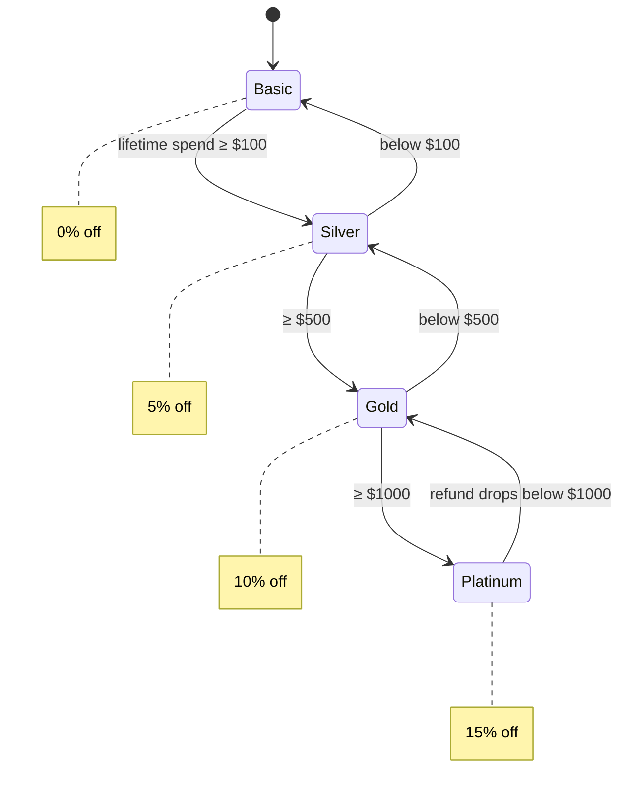

# TierMart — a customer-tier store (COE 528)

A small store application where a customer's membership tier — Basic → Silver → Gold →
Platinum — changes automatically as they spend, and each tier gives a bigger discount.
The tiers are built with the **State design pattern**, so there isn't a single `if/else`
chain deciding discounts anywhere in the code.

> COE 528 — Object-Oriented Analysis & Design. The point of this project isn't the store;
> it's the design: the State pattern, design-by-contract specifications on the methods that
> matter, and a clean separation between the model, the business rules, and the two
> front-ends (a Swing GUI and a CLI) that sit on top of the exact same logic.

```
make demo       # watch a customer climb the tiers and get demoted on a refund
make run-cli    # text menu
make run-gui    # Swing desktop app (needs a display)
```

---

## The State pattern, which is the whole point

A customer's tier decides their discount *and* when they move up or down. The naive way
is a `switch` on an enum, repeated everywhere a discount or a promotion is checked. The
State pattern replaces that: each tier is its own class that knows its discount and its
own transition rules, and the `Customer` (the *context*) just delegates.



When a purchase or refund changes a customer's lifetime spend, the customer asks its
current state to `review()` itself. The state checks the thresholds and, if needed, swaps
in the neighbouring state. Adding a fifth tier later is **one new class** — no existing
code changes. That's the open/closed principle paying off.

```java
// Customer delegates; it never decides its own tier.
public void recordPurchase(long paidCents) {
    walletCents -= paidCents;
    totalSpentCents += paidCents;
    reviewUntilStable();            // asks the current state to promote/demote
}
```

---

## What's in here

```
src/tiermart/
  model/
    Product.java            a catalogue item (price in cents, stock)
    Customer.java           THE CONTEXT: wallet, lifetime spend, current state
    Store.java              in-memory catalogue + customer list
    Receipt.java            result of a purchase (discount, tier before/after)
    membership/
      MembershipState.java  THE STATE interface: name(), discountRate(), review()
      Tiers.java            the thresholds, in one place
      BasicState.java  SilverState.java  GoldState.java  PlatinumState.java
  service/
    StoreService.java       THE BUSINESS RULES (purchase, refund) with contracts
    SampleData.java         seeds a store so the UIs have something to show
  app/
    Main.java               entry point: cli | gui | demo
    Cli.java                text front-end
    Gui.java                Swing desktop front-end
    SelfCheck.java          scripted proof the transitions are correct
docs/
    DESIGN.md               patterns, SOLID, design-by-contract, UML
    SETUP-AND-RUN.md        step-by-step run + GitHub instructions
    uml/state-diagram.svg
    TierMart-Guide.pdf
```

The layering is deliberate: **model** (data + the state machine) knows nothing about the
UI; **service** holds the business rules; **app** is just front-ends calling the service.
Swapping the in-memory store for a database would be a change in one layer.

---

## Design by contract

The methods that change state carry a `@requires / @modifies / @effects` contract in their
Javadoc — the design-by-contract style from the course. For example, `StoreService.purchase`:

```
@requires the customer and product exist && qty >= 1 && enough stock &&
          the customer can afford the discounted total
@modifies the customer (wallet, lifetime spend, possibly tier) and the product (stock)
@effects  applies the current-tier discount, charges the discounted total, reduces
          stock, re-evaluates the tier, and returns a Receipt
```

The preconditions are also enforced at runtime (they throw if broken), so the contract
isn't just a comment — breaking it fails loudly instead of corrupting state.

---

## What `make demo` prints

```
action                     tier       discount  spent
------------------------------------------------------------
start                      Basic      0%        $0.00
buy keyboard ($89)         Basic      0%        $89.00
buy monitor ($279)         Silver     5%        $368.00
buy monitor (5% off)       Gold       10%       $633.05
buy 2 monitors (10% off)   Platinum   15%       $1135.25
refund $900                Silver     5%        $235.25
All checks passed -- the State pattern promotes and demotes correctly.
```

One large purchase can jump several tiers at once (a single $558 order takes a new
customer straight to Gold), and a refund walks the customer back down — both directions
go through the same state machine.

---

## Honest notes on scope

- **Data is in memory.** Customers and the catalogue reset when you close the app. A real
  system would persist to a database; the model is deliberately separated from the rest so
  that would be a one-layer change.
- **No login / roles.** Anyone can act as the owner or a customer. The focus here is the
  design, not authentication.
- **Money is in integer cents**, not floating point — small thing, but it's the right call
  so discounts never leave a rounding error on a price.

## Built with
Java 17 · Swing (bundled with the JDK) · no external libraries · the State design pattern
