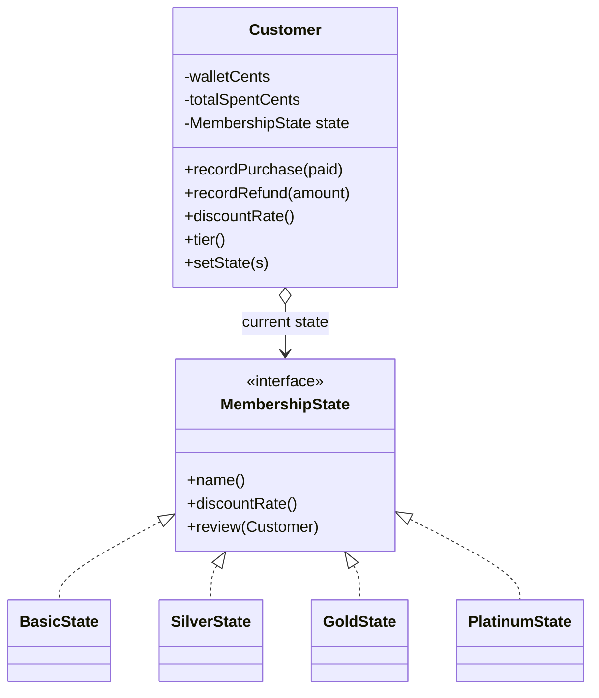
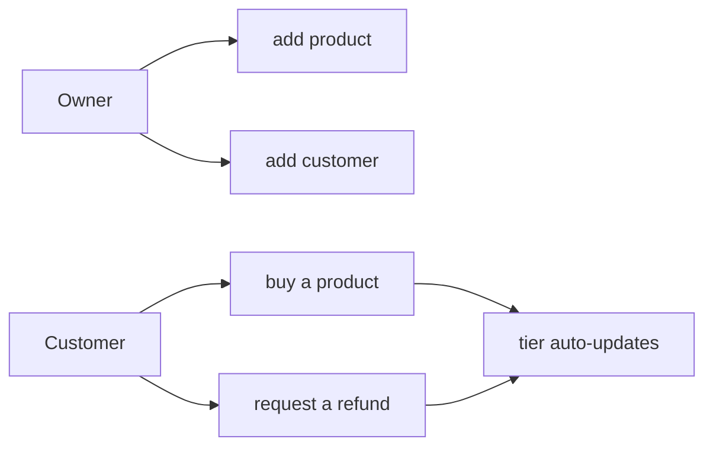

# Design notes — TierMart (COE 528)

This is the document that explains *why* the code is shaped the way it is: the pattern, the
class structure, the SOLID principles it leans on, and the design-by-contract specs.

---

## 1. The design problem

A store wants to reward customers who spend more with bigger discounts, and the reward
level should move up (and back down, on refunds) on its own as spending changes. The
naive solution scatters the tier logic everywhere:

```java
// the anti-pattern this project avoids
double discount;
if (tier == Tier.BASIC)         discount = 0.0;
else if (tier == Tier.SILVER)   discount = 0.05;
else if (tier == Tier.GOLD)     discount = 0.10;
else                            discount = 0.15;
// ...and the same switch again wherever a promotion is checked
```

Every new tier means editing every one of those switches, and it's easy to update one and
forget another. That's exactly the smell the **State pattern** removes.

---

## 2. The State pattern

Each tier becomes a class implementing `MembershipState`, which knows two things: its
discount, and — given a customer's spend — which tier the customer should now be in. The
`Customer` is the *context*; it holds a reference to its current state and delegates.



- **Context** = `Customer`. It never asks "what tier am I?" with a conditional; it calls
  `state.discountRate()` and `state.review(this)`.
- **State** = `MembershipState`. Each concrete state encapsulates its own discount and its
  transitions to its neighbours.
- **Transition** = a state calls `customer.setState(new OtherState())` from inside
  `review()`. The customer loops `review()` until the tier stops changing, so one big
  purchase can climb several tiers while each state still only knows about its neighbours.

---

## 3. SOLID, concretely

- **S — Single responsibility.** `model` holds data + the state machine, `service` holds
  business rules, `app` holds UI. `StoreService` decides purchases; `Customer` tracks one
  shopper; each state class owns one tier.
- **O — Open/closed.** Add a "Diamond" tier by writing one `DiamondState` class and one
  threshold. No existing class changes.
- **L — Liskov substitution.** Every `MembershipState` is usable wherever the interface is
  expected; the `Customer` treats them identically.
- **I — Interface segregation.** `MembershipState` has exactly three methods — nothing a
  state doesn't need.
- **D — Dependency inversion.** The UIs depend on `StoreService` (a higher-level
  abstraction), not on the model internals; `Customer` depends on the `MembershipState`
  interface, not on the concrete tiers.

---

## 4. Design by contract

The state-changing methods specify a contract the course asks for:

| Method | @requires | @modifies | @effects |
|---|---|---|---|
| `StoreService.purchase` | customer & product exist, qty ≥ 1, stock & funds sufficient | customer, product | applies discount, charges, reduces stock, re-tiers, returns Receipt |
| `StoreService.refund` | customer exists, 0 ≤ amount ≤ lifetime spend | customer | returns money, re-tiers (may demote) |
| `Customer.recordPurchase` | 0 ≤ paid ≤ wallet | customer | deducts, adds to spend, re-reviews tier |
| `MembershipState.review` | customer's state is this | customer | sets the correct neighbouring tier |

The preconditions are enforced at runtime — they throw rather than silently corrupt state —
so the contract is executable, not just documentation.

---

## 5. Representation choices

- **Money is integer cents** (`long`), never `double`. Discounts round once, at the point
  of sale, with `Math.round` — so a 5% discount on $12.99 can't leave a fraction of a cent.
- **Tiers are driven by lifetime spend** (money actually paid, after discounts), kept on
  the `Customer`. One number drives the whole ladder, which is why promotion and demotion
  are symmetric.
- **The store is in-memory** (`LinkedHashMap`). Because the model is isolated from the
  service and UI, replacing it with a JDBC/JPA repository would touch only the model layer.

---

## 6. Use cases (what the actors can do)



The CLI exposes all of these from one menu; the GUI exposes buy/refund and shows the tier
updating live.
